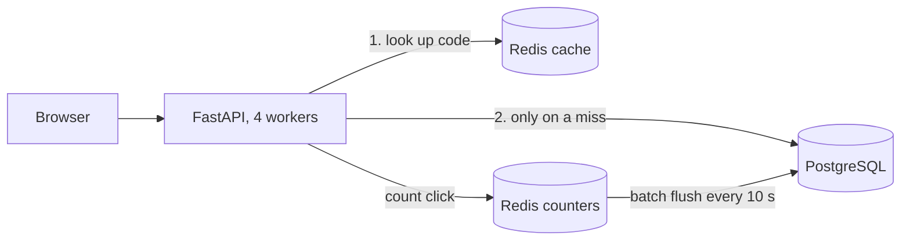

# Snip


A high-throughput URL shortener with a Redis cache-aside layer, built with FastAPI, PostgreSQL, Redis and Docker.

## How it works



On a cache hit, a redirect is two Redis calls and never touches Postgres.

## API

| Method | Path | What it does |
| --- | --- | --- |
| POST | `/shorten` | Create a short link. Body: `url`, optional `alias`, optional `expires_in_minutes` |
| GET | `/{code}` | 302 redirect to the long URL (404 unknown, 410 expired) |
| GET | `/stats/{code}` | Link details and click count |
| GET | `/health` | Checks Postgres and Redis |

Example:

```bash
curl -X POST localhost:8000/shorten -H "Content-Type: application/json" -d '{"url": "https://github.com"}'
```

## Run it

```bash
docker compose up -d --build
```

Then open http://localhost:8000/docs.

## Run the tests

```bash
python -m venv .venv && source .venv/bin/activate
pip install -r requirements.txt -r requirements-dev.txt
docker compose up -d db redis
pytest -v
```

24 integration tests run against real Postgres and Redis, with a clean state per test.

## Design decisions

- **302, not 301.** Browsers cache 301s permanently, which would bypass click counting and make links impossible to expire or change.
- **Random base62 codes.** 7 characters give 62^7 (about 3.5 trillion) codes. Random instead of sequential so links can't be enumerated. Collisions are retried.
- **Cache-aside with negative caching.** Unknown codes are cached as "not found" for 60 seconds so scans for random codes can't hammer Postgres. Creating a link invalidates its cache entry, fixing a stale-404 bug this introduced.
- **TTL capped at expiry.** A cached link never outlives its expiry time.
- **Batched click counting.** Clicks increment a Redis hash and are flushed to Postgres every 10 seconds in one UPDATE, taken with an atomic RENAME so no click is double-counted. Trade-off: up to 10 seconds of clicks can be lost if Redis crashes, acceptable for analytics.
- **Fixed-window rate limiting.** 10 link creations per IP per minute. Simple and cheap; the trade-off is a possible burst of 20 across a minute boundary.

## Tech

Python 3.13, FastAPI, SQLAlchemy 2 (async) with asyncpg, PostgreSQL 16, Redis 7, Docker Compose, pytest, Locust, GitHub Actions.

## Benchmark

Locust, 50 users for 2 minutes against 4 Uvicorn workers in Docker, on a Windows laptop. 10,000 seeded links; traffic is 90% to 200 hot links, 8% to any link, 2% to codes that don't exist.

| Run | Requests | Throughput | p50 (ms) | p95 (ms) | Cache hit rate |
| --- | --- | --- | --- | --- | --- |
| Cache off | 67,639 | 568 req/s | 14 | 300 | n/a |
| Cache on | 147,694 | 1,236 req/s | 6 | 13 | 93.3% |

The 2% of requests to non-existent codes return 404 by design; Locust reports them as failures. Locust and the API shared one laptop's CPU, so absolute latencies are higher than on dedicated hardware; the comparison between the two runs is what matters.